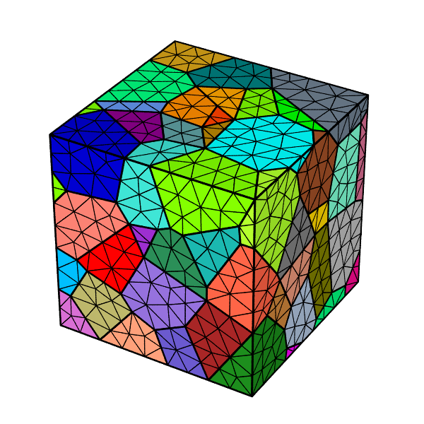

.. _quickstart:

Quick Start
===========

A first polycrystal in a minute: a tessellation of 100 cells (grains), regularized, and meshed into finite elements.

1. Install Neper (see :ref:`installation`).

2. Generate the tessellation:

   .. code-block:: console

     $ neper -T -n 100 -reg 1

   This writes the :ref:`tess_file` :file:`n100-id1.tess`, a Voronoi tessellation of 100 cells in a unit cube (option :option:`-n`).  Option :option:`-reg` regularizes it, that is, removes its small edges and faces, so that it can be meshed with high-quality elements.

3. Mesh the tessellation:

   .. code-block:: console

     $ neper -M n100-id1.tess

   This writes the :ref:`mesh_file` :file:`n100-id1.msh`, made of 10-node tetrahedral elements (one element set per cell).  It can be used directly by FEPX (as :file:`simulation.msh`), whose results Neper post-processes with the :ref:`neper_s`.

4. Visualize the tessellation and the mesh:

   .. code-block:: console

     $ neper -V n100-id1.tess -print tess
     $ neper -V n100-id1.tess,n100-id1.msh -showelt1d all -print mesh

   This writes the PNG images :file:`tess.png` and :file:`mesh.png`:

   |tess| |mesh|

Next: :ref:`neper_t`, :ref:`neper_m` and :ref:`neper_v` describe the modules, and :ref:`tutorials` gives more examples (see in particular :ref:`mesh_tessellation`).
