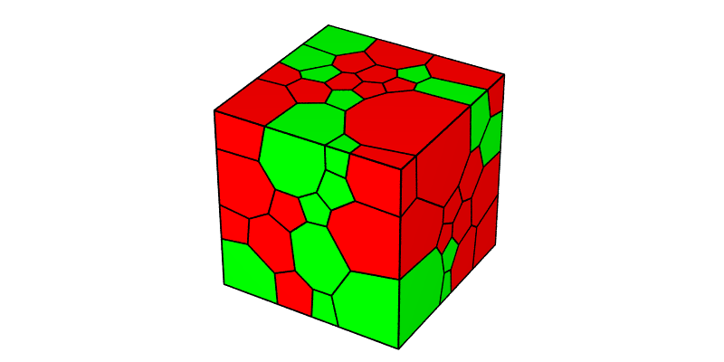
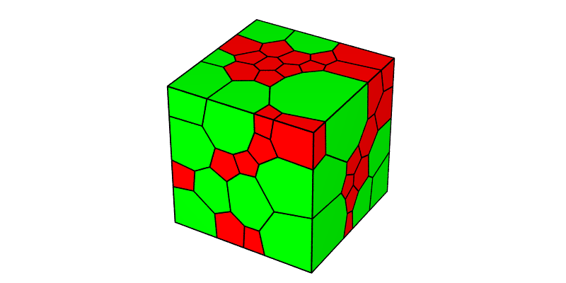
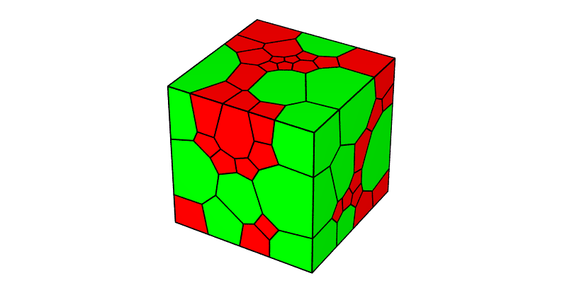

.. _cell_groups:

Defining Cell Groups (-T)
=========================

.. note::

  This tutorial presents the :option:`-group` and :option:`-statgroup` options of the :ref:`neper_t`.  Read first: :ref:`morpho_statistics`.  For details on the use of the :ref:`neper_v` in this tutorial, see :ref:`visualize_tessellation`.

  To reproduce *exactly* the images below, add the following line to your :file:`$HOME/.neperrc` file (or to a local configuration file to be loaded with :data:`--rcfile`)::

    neper -V -imagesize 800:400

Cell groups can be defined to represent, for example, the different phases of a multiphase polycrystalline material.  Each cell is assigned to a group, using option :option:`-group`.  Groups are computed after the tessellation, so that they can be defined from the cell properties.

When a tessellation is meshed using the :ref:`neper_m`, the cell groups are transferred to the corresponding element sets and written in the :data:`$Groups` section of the :ref:`mesh_file`.  The groups can also be written in a separate file of extension :file:`.phase` (for `FEPX <https://fepx.info>`_), using :option:`-format` :data:`msh,phase`.

Defining Groups from Cell Identifiers
-------------------------------------

Groups can be defined from an expression based on the variables defined in :ref:`tessellation_keys`, using the C/C++ ternary syntax, :data:`(\<test\>)?\<value_if_true\>:\<value_if_false\>`.  As the cell identifiers are not related to the cell positions, a random distribution of two phases, each comprising half of the cells, can be obtained from the cell identifiers, as follows:

.. code-block:: console

  $ neper -T -n 100 -morpho gg -group "id<=50?1:2" -statgroup vol

This produces a :ref:`tess_file` named :file:`n100-id1.tess`, in which the cell groups are recorded, and a statistics file, :file:`n100-id1.stgroup`, which contains the volumes of the groups (see :ref:`tessellation_keys`), i.e. their volume fractions, as the domain is of unit volume::

  0.560857941272
  0.439142058728

The tessellation can be visualized using the :ref:`neper_v`, coloring the cells by their groups:

.. code-block:: console

  $ neper -V n100-id1.tess -datacellcol group -print img1

Defining Groups from Cell Properties
------------------------------------

Groups can also be defined from the cell geometrical properties.  For example, the cells of volume larger than 0.015 (for an average cell volume of 0.01) can be assigned to group 2 and the other cells to group 1, as follows:

.. code-block:: console

  $ neper -T -n 100 -morpho gg -group "vol>0.015?2:1" -statgroup vol

The volumes of the groups are now::

  0.440947890358
  0.559052109642

The tessellation can be visualized as before:

.. code-block:: console

  $ neper -V n100-id1.tess -datacellcol group -print img2

Defining Groups from a Multimodal Cell Size Distribution
--------------------------------------------------------

Groups are typically used to represent the phases of a multiphase material, which may have different cell size distributions.  In this case, the tessellation can be generated from a multimodal cell size distribution (see :ref:`morpho_statistics`), and the groups can be defined from the modes of the distribution, using :data:`mode` (see :ref:`tessellation_keys`).  For example, a tessellation with a bimodal cell size distribution, where 80% of the cells have an average equivalent diameter of 1 and 20% of the cells have an average equivalent diameter of 2 (in relative values), can be generated with one group per mode as follows:

.. code-block:: console

  $ neper -T -n 100 -morpho "diameq:0.8*lognormal(1,0.35)+0.2*lognormal(2,0.6),1-sphericity:lognormal(0.145,0.03)" -group mode -statgroup vol -o bimodal

This produces a :ref:`tess_file` named :file:`bimodal.tess`, where group 1 contains 80 cells and group 2 contains 20 cells.  The volumes of the groups are::

  0.355589449623
  0.644410550377

The tessellation can be visualized as before:

.. code-block:: console

  $ neper -V bimodal.tess -datacellcol group -print img3

.. note:: Groups can also be loaded from a :ref:`data_file`, using :option:`-group` :data:`file(<file_name>)`.
