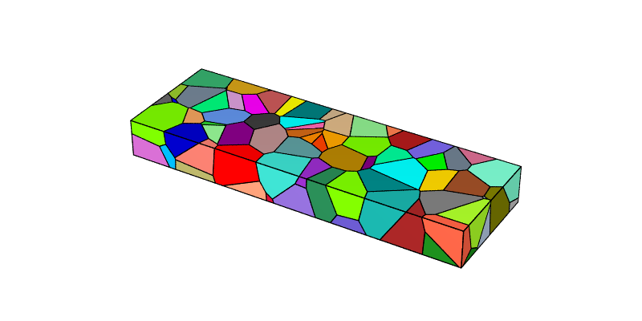
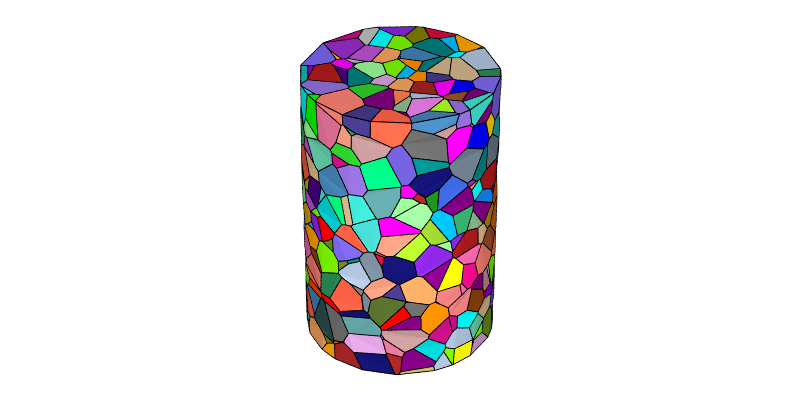
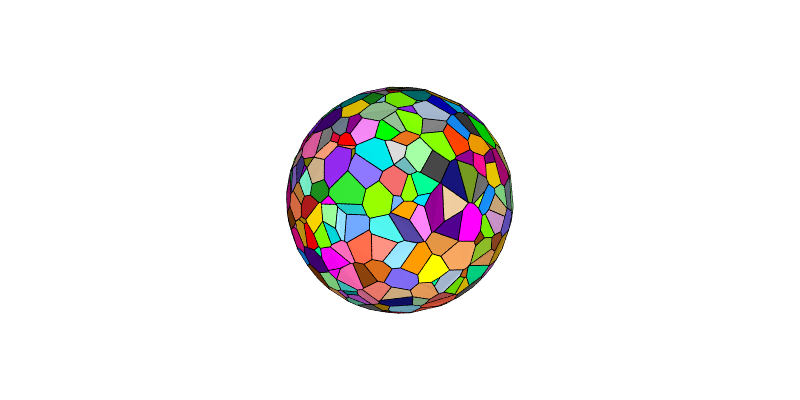
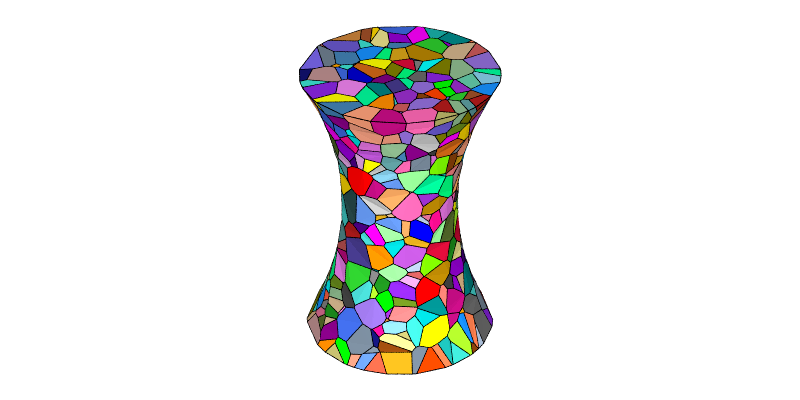
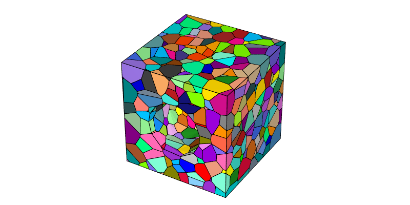
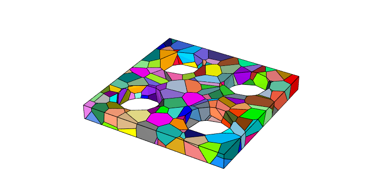

.. _domain_cutting:

Defining the Domain and Cutting (-T)
====================================

.. note::

  This tutorial presents the :option:`-domain` and :option:`-transform` options of the :ref:`neper_t`.  Read first: :ref:`voronoi_tessellation`.  For details on the use of the :ref:`neper_v` in this tutorial, see :ref:`visualize_tessellation`.

  To reproduce *exactly* the images below, add the following line to your :file:`$HOME/.neperrc` file (or to a local configuration file to be loaded with :data:`--rcfile`)::

    neper -V -imagesize 800:400

Defining the Domain (:option:`-domain`)
---------------------------------------

The domain can be defined using :option:`-domain` (the default value is :data:`"cube(1,1,1)"` in 3D and :data:`"square(1,1)"` in 2D). For example, an elongated cuboidal domain of dimensions :math:`3 \times 1 \times 0.33` can be obtained as follows:

.. code-block:: console

  $ neper -T -n 100 -domain "cube(3,1,0.33)"

This produces a :ref:`tess_file` named :file:`n100-id1.tess`.

The tessellation can be visualized using the :ref:`neper_v`:

.. code-block:: console

  $ neper -V n100-id1.tess -print img1

Similarly, a cylindrical domain of height 1.5 and diameter 1 can be obtained as follows:

.. code-block:: console

  $ neper -T -n 1000 -domain "cylinder(1.5,1)"

This produces a :ref:`tess_file` named :file:`n1000-id1.tess`.  The domain is exact (curved).  A faceted domain can be obtained by providing the number of facets, as in :data:`"cylinder(1.5,1,50)"`.

The tessellation can be visualized as before (each curved cell face is represented as a planar polygon):

.. code-block:: console

  $ neper -V n1000-id1.tess -print img2

A spherical domain of diameter 1, as used to model a powder particle, can be obtained in the same way:

.. code-block:: console

  $ neper -T -n 1000 -domain "sphere(1)"

This produces a :ref:`tess_file` named :file:`n1000-id1.tess`, which can be visualized as before:

.. code-block:: console

  $ neper -V n1000-id1.tess -print img3

An hourglass domain of height 1.5, end diameter 1 and center diameter 0.6 can be obtained as follows:

.. code-block:: console

  $ neper -T -n 1000 -domain "hourglass(1.5,1,0.6)"

This produces a :ref:`tess_file` named :file:`n1000-id1.tess`, which can be visualized as before:

.. code-block:: console

  $ neper -V n1000-id1.tess -print img4

Cutting Tessellations (:option:`-transform`)
--------------------------------------------

Tessellations can be cut by geometrical primitives once generated, using :option:`-transform` :data:`cut` (the region interior to the primitives is removed).  For example, a cube with a cylindrical hole of radius 0.25, along :data:`y` and through its center, can be obtained as follows:

.. code-block:: console

  $ neper -T -n 1000 -transform "cut(cylinder(0.5,0,0.5,0,1,0,0.25))"

This produces a :ref:`tess_file` named :file:`n1000-id1.tess`, which can be visualized as before:

.. code-block:: console

  $ neper -V n1000-id1.tess -print img5

Several primitives can be combined.  For example, a plate of thickness 0.1 drilled with four holes of diameter 0.3 (radius 0.15) along :data:`z` can be obtained as follows:

.. code-block:: console

  $ neper -T -n 200 -domain "cube(1,1,0.1)" -transform "cut(cylinder(0.25,0.25,0,0,0,1,0.15),cylinder(0.25,0.75,0,0,0,1,0.15),cylinder(0.75,0.25,0,0,0,1,0.15),cylinder(0.75,0.75,0,0,0,1,0.15))" -o plate

This produces a :ref:`tess_file` named :file:`plate.tess`, which can be visualized as before:

.. code-block:: console

  $ neper -V plate.tess -print img6

.. note :: Other primitives (sphere, torus, half-space, etc.) are available, see :option:`-transform`.
