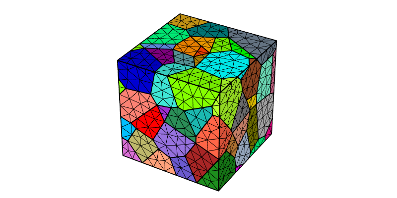
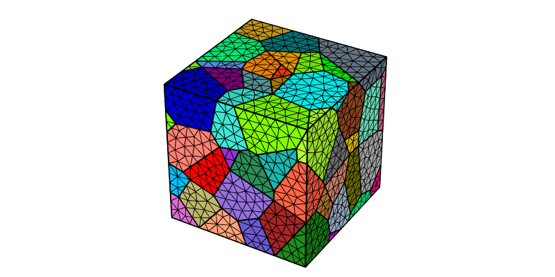
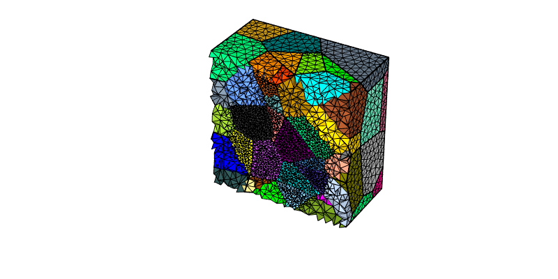
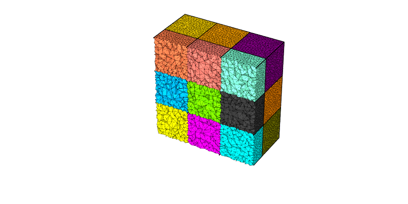
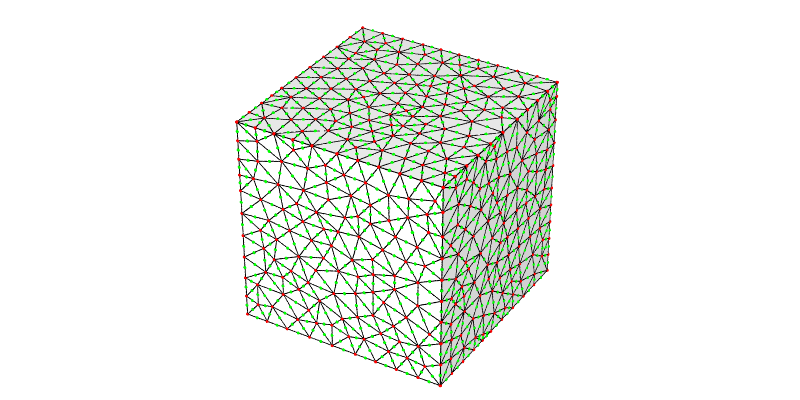
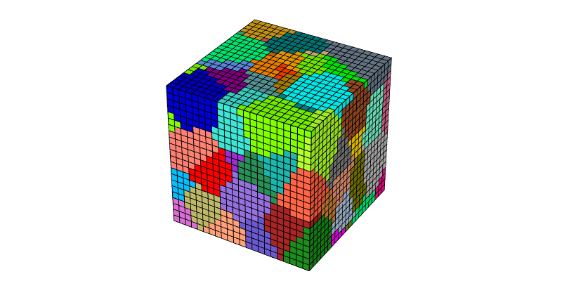
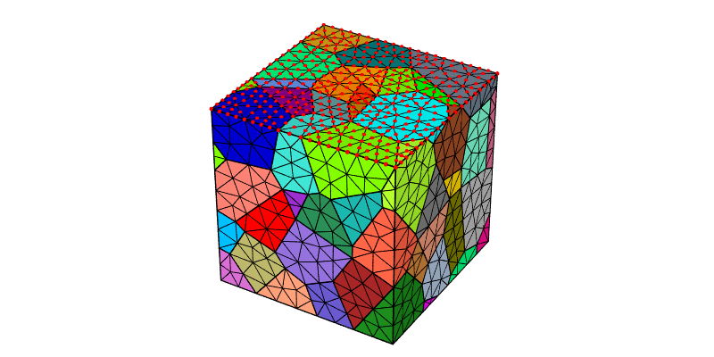
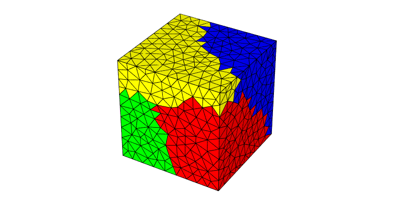

.. _mesh_tessellation:

Meshing a Tessellation (-T, -M)
===============================

.. note::

  This tutorial presents the :data:`-rcl`, :data:`-rcl{ver,edge,face,poly}`, :option:`-pl`, :option:`-order`, :option:`-elttype`, :option:`-nset` and :option:`-part` options of the :ref:`neper_m` and the :option:`-reg` option of the :ref:`neper_t`.  Read first: :ref:`voronoi_tessellation`.  For details on the use of the :ref:`neper_v` in this tutorial, see :ref:`visualize_mesh`.

  To reproduce *exactly* the images below, add the following line to your :file:`$HOME/.neperrc` file (or to a local configuration file to be loaded with :data:`--rcfile`)::

    neper -V -imagesize 800:400

Regularizing the Tessellation and Generating a Mesh
---------------------------------------------------

The only required input to mesh a tessellation is the tessellation itself.  For a 100-cell Voronoi tessellation:

.. code-block:: console

  $ neper -T -n 100
  $ neper -M n100-id1.tess

This produces a :ref:`tess_file` named :file:`n100-id1.tess` and a :ref:`mesh_file` named :file:`n100-id1.msh`.

The mesh can be visualized using the :ref:`neper_v`, highlighting the cell boundaries via the 1D elements (:data:`-showelt1d`):

.. code-block:: console

  $ neper -V n100-id1.tess,n100-id1.msh -showelt1d all -print img1

.. note::

  When both the tess file and mesh file are available, it is a good practice to pass both of them to module -V by using the :data:`,` separator.  Only the mesh is printed.

It is quite clear from the above image that the mesh is overrefined at some locations, which is where *small edges* typical of Voronoi tessellations are.  Neper includes a strategy called *regularization* (option :option:`-reg`) that removes the smallest edges of the tessellation [CMAME2011]_:

.. code-block:: console

  $ neper -T -n 100 -reg 1
  $ neper -M n100-id1.tess
  $ neper -V n100-id1.tess,n100-id1.msh -showelt1d all -print img2

The resulting tessellation is very similar to the original one, as only slight morphological changes occur during regularization.  However, the local mesh overrefinements disappear.

The effect of regularization can be quantified by writing the lengths of the edges, using option :option:`-statedge` (see :ref:`tessellation_keys`), for the tessellations without and with regularization:

.. code-block:: console

  $ neper -T -n 100 -statedge length -o noreg
  $ neper -T -n 100 -reg 1 -statedge length -o reg

This produces files named :file:`noreg.stedge` and :file:`reg.stedge`, which contain the edge lengths.  The tessellation without regularization has 1146 edges, 119 of which are shorter than 0.02 (the shortest has a length of 0.0003), while the tessellation with regularization has 776 edges, none of which is shorter than 0.044.  As a result, when meshed using the default parameters, the tessellation without regularization produces 23902 elements, against 7400 elements with regularization.

This mesh can be used by `FEPX <https://fepx.info>`_.  In the following, the regularized tessellation, :file:`n100-id1.tess`, is used (except where otherwise noted).

Setting the Element Size
------------------------

The element size or *characteristic length* can be set using option :data:`-rcl`, which is relative to the average cell size (the default value is :data:`1`).  For example, a finer mesh can be obtained as follows:

.. code-block:: console

  $ neper -M n100-id1.tess -rcl 0.7
  $ neper -V n100-id1.tess,n100-id1.msh -showelt1d all -print img3

Setting the Element Size Cell by Cell
-------------------------------------

Option :data:`-rcl` (or :option:`-cl`) can also take an expression based on the :ref:`tessellation_keys`, which defines the element size of each cell.  For example, the interior cells (:data:`body>0`) can be meshed more finely than the cells at the domain boundary, as follows:

.. code-block:: console

  $ neper -M n100-id1.tess -rcl "body>0?0.2:0.5"

The interior cells can be revealed by showing only the elements of the half :data:`y>0.5` of the domain (and their 1D elements):

.. code-block:: console

  $ neper -V n100-id1.tess,n100-id1.msh -showelt "y>0.5" -showelt1d elt3d_shown -print img4

Setting the Element Size at Vertices, Edges, Faces and Polyhedra
----------------------------------------------------------------

The element size can also be set at the level of the different tessellation entities, using options :data:`-rcl{ver,edge,face,poly}`, while :data:`-rcl` applies to all of them.  The element size then increases from the vertices to the edges, the faces and the polyhedra at a rate defined by option :option:`-pl`, which provides an element size gradient.

For example, for a tessellation into 27 cubic cells (see :ref:`regular_tessellation`), a fine mesh can be obtained at the cell faces and a coarser mesh in the cell interiors, as follows:

.. code-block:: console

  $ neper -T -n from_morpho -morpho "cube(3)" -o d
  $ neper -M d.tess -rcl 1 -rclface 0.15 -pl 1.5
  $ neper -V d.tess,d.msh -showelt "y>0.5" -showelt1d elt3d_shown -dataelt3dedgerad "default*0.25" -dataelt1drad "default*0.5" -print img5

A finer mesh can also be obtained at the cell edges (the triple lines), so that the element size increases from the edges to the face interiors and then to the cell interiors:

.. code-block:: console

  $ neper -M d.tess -rcl 1 -rclface 0.15 -rcledge 0.05 -pl 1.5
  $ neper -V d.tess,d.msh -showelt "y>0.5" -showelt1d elt3d_shown -dataelt3dedgerad "default*0.25" -dataelt1drad "default*0.5" -print img6

Setting the Element Order
-------------------------

By default, the mesh is made of quadratic elements (order 2, i.e. 10-node tetrahedra).  Linear elements (order 1, i.e. 4-node tetrahedra) can be obtained using :option:`-order` :data:`1`:

.. code-block:: console

  $ neper -M n100-id1.tess -order 1

The number of elements does not change (7400 elements), but the number of nodes decreases from 11152 to 1548.

In a mesh of order 2, the first-order nodes (at the element vertices) are numbered first, and so they are the first 1548 nodes of the mesh.  The nodes can therefore be colored according to their order using an expression based on their identifiers:

.. code-block:: console

  $ neper -M n100-id1.tess
  $ neper -V n100-id1.tess,n100-id1.msh -dataeltcol white -showelt1d all -dataelt1drad "default*0.5" -shownode all -datanodecol "int:(id>1548)+1" -datanoderad "default*0.75" -print img7

The first-order nodes are shown in red and the second-order nodes, at the middle of the element edges, in green.

Generating a Hexahedral Mesh
----------------------------

A mesh into hexahedral elements that conforms to the cell boundaries (obtained by splitting tetrahedral elements) can be generated using :option:`-elttype` :data:`hex`:

.. code-block:: console

  $ neper -M n100-id1.tess -elttype hex

A grid mesh of hexahedral elements (a non-conforming mesh, as the cell boundaries are not followed exactly) can be generated using :option:`-elttype` :data:`hexgrid`:

.. code-block:: console

  $ neper -M n100-id1.tess -elttype hexgrid
  $ neper -V n100-id1.tess,n100-id1.msh -print img8

Defining Node Sets
------------------

Node sets, which are typically used to apply boundary conditions, are written in the :data:`$NSets` section of the :ref:`mesh_file`.  By default, they are the node sets of the domain faces, edges and vertices, which, for a cubic domain, makes 26 node sets, named :data:`x0`, :data:`x1`, etc. for the faces, :data:`x0y0`, :data:`x0y1`, etc. for the edges and :data:`x0y0z0`, :data:`x1y0z0`, etc. for the vertices.

The node sets can be specified using :option:`-nset`.  For example, to get only the node sets of the bottom and top faces of the domain:

.. code-block:: console

  $ neper -M n100-id1.tess -nset z0,z1

Custom node sets can also be defined, using the syntax :data:`label:definition`.  The definition can be an expression based on the node variables (see :ref:`mesh_keys`), :data:`min(expr)` or :data:`max(expr)` for the nodes for which an expression is minimal or maximal, or :data:`closest(x,y,z)` for the node closest to a point.  For example, three custom node sets can be added to the default ones as follows:

.. code-block:: console

  $ neper -M n100-id1.tess -nset "faces,edges,vertices,left:x<0.5,top:max(z),center:closest(0.5,0.5,0.5)"

This provides 29 node sets, including :data:`left` (5607 nodes), :data:`top` (477 nodes, i.e. those of :data:`z1`) and :data:`center` (1 node).

A node set can be visualized using :data:`-shownode`, which can take the expression :data:`nset==top`:

.. code-block:: console

  $ neper -V n100-id1.tess,n100-id1.msh -showelt1d all -dataelt1drad "default*0.75" -shownode nset==top -datanodecol red -print img9

Partitioning the Mesh
---------------------

The mesh can be divided into partitions, for parallel computations, using :option:`-part`.  The partitions have similar numbers of nodes and elements, and the interfaces between them are minimized.  For example, to get 4 partitions:

.. code-block:: console

  $ neper -M n100-id1.tess -part 4

The mesh can be visualized by coloring the elements by partition:

.. code-block:: console

  $ neper -V n100-id1.tess,n100-id1.msh -dataeltcol part -print img10

