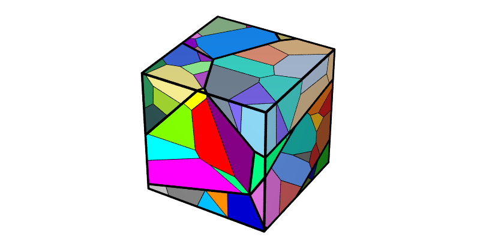
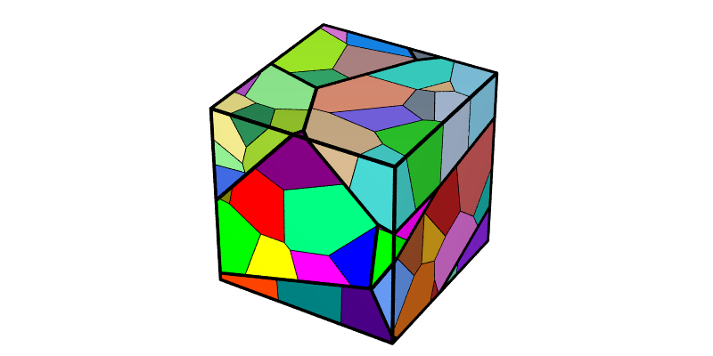
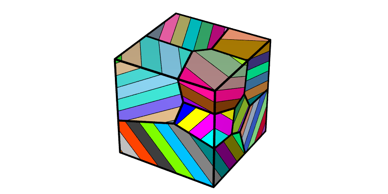
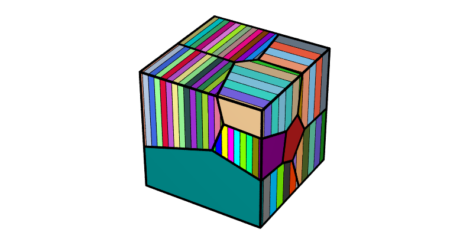
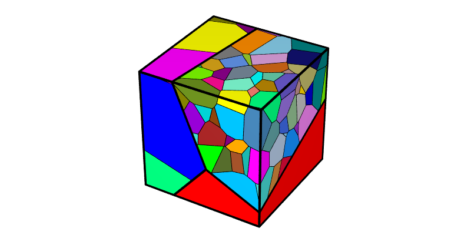
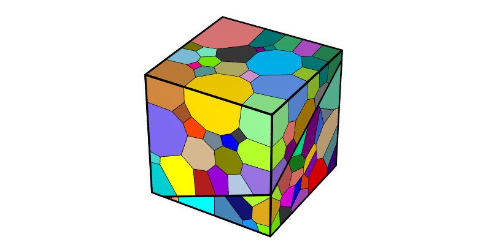
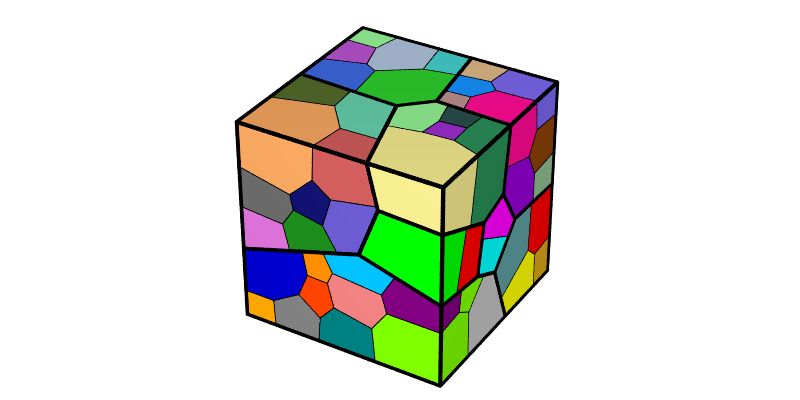
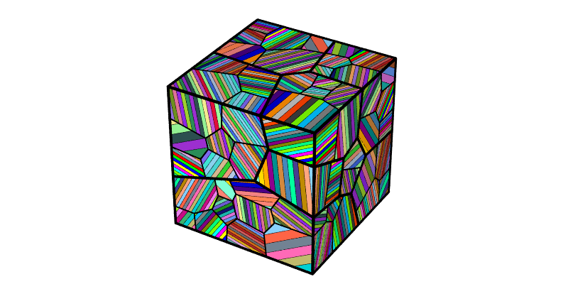
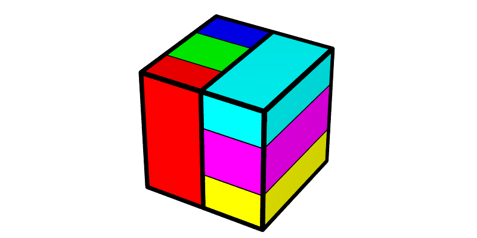

.. _multiscale_tessellation:

Generating a Multiscale Tessellation (-T)
=========================================

.. note::

  This tutorial presents the use of the :data:`::` separator and of the :option:`-n`, :option:`-id`, :option:`-morpho` and :option:`-morphooptiini` options of the :ref:`neper_t` for multiscale tessellations.  Read first: :ref:`voronoi_tessellation` and :ref:`morpho_statistics`.  For details on the use of the :ref:`neper_v` in this tutorial, see :ref:`visualize_tessellation`.

  To reproduce *exactly* the images below, add the following line to your :file:`$HOME/.neperrc` file (or to a local configuration file to be loaded with :data:`--rcfile`)::

    neper -V -imagesize 800:400

In a multiscale tessellation, the cells of a primary tessellation are subdivided into secondary tessellations (and so on).  Multiscale tessellations are obtained by combining, using :data:`::`, the option arguments that apply at the successive scales.  All capabilities available for generating a standard (single-scale) tessellation are available at each scale.

Generating a 2-Scale Tessellation
---------------------------------

A 2-scale Voronoi tessellation of 10 primary cells, each divided into 10 secondary cells, can be generated as follows:

.. code-block:: console

  $ neper -T -n 10::10 -o n10x10

This produces a :ref:`tess_file` named :file:`n10x10.tess`.

.. note:: Option :option:`-o` is used to set the output file name, as the default file name, :file:`n10::10-id1::1.tess`, contains :data:`::`.

The tessellation can be visualized using the :ref:`neper_v`, showing the edges of the primary cells (and of the domain) with a larger radius than the edges of the secondary cells, from their :data:`scale` (see :ref:`tessellation_keys`):

.. code-block:: console

  $ neper -V n10x10.tess -dataedgerad "(scale<=1)?default*2:default*0.5" -print img1

This produces a PNG file named :file:`img1.png`, where the (secondary) cells are colored by their ids.

The tessellations at the different scales can be changed using :option:`-id`, whose argument can also be defined at each scale.  For example, to change the secondary tessellations only:

.. code-block:: console

  $ neper -T -n 10::10 -id 1::2 -o n10x10-id2

The tessellation can be visualized as before:

.. code-block:: console

  $ neper -V n10x10-id2.tess -dataedgerad "(scale<=1)?default*2:default*0.5" -print img2

The primary cells are unchanged, while the secondary cells are different.

Generating a Lamellar Microstructure
------------------------------------

A typical use of multiscale tessellations is to generate a lamellar microstructure, in which grains are divided into lamellae.  This is done using :option:`-morpho` :data:`lamellar` at the secondary scale, which requires the number of secondary cells to be determined from the morphology (:data:`from_morpho`).  For example, 10 primary cells with grain-growth properties, divided into lamellae of width 0.1, can be obtained as follows:

.. code-block:: console

  $ neper -T -n 10::from_morpho -morpho "gg::lamellar(w=0.1)" -o lam

The lamella plane normals are random by default.  The tessellation can be visualized as before:

.. code-block:: console

  $ neper -V lam.tess -dataedgerad "(scale<=1)?default*2:default*0.5" -print img3

Specifying Cell-by-Cell Values
------------------------------

Different values can be specified for the different cells of a scale, by loading them from a :ref:`multiscale_cell_file`, using :data:`msfile(<file_name>)`.  For the secondary tessellations, such a file contains, for each primary cell, its identifier followed by the value(s).

For example, the lamella widths and plane normals can be specified for each primary cell.  Consider a file, :file:`lam_width`, containing the lamella widths::

  1 0.05
  2 0.10
  3 0.05
  4 0.10
  5 0.05
  6 0.10
  7 0.05
  8 0.10
  9 0.05
  10 0.10

and a file, :file:`lam_normal`, containing the lamella plane normals::

  1 1 0 0
  2 0 1 0
  3 1 0 0
  4 0 1 0
  5 1 0 0
  6 0 1 0
  7 1 0 0
  8 0 1 0
  9 1 0 0
  10 0 1 0

The tessellation can be generated as follows:

.. code-block:: console

  $ neper -T -n 10::from_morpho -morpho "gg::lamellar(w=msfile(lam_width),v=msfile(lam_normal))" -o lam2

and visualized as before:

.. code-block:: console

  $ neper -V lam2.tess -dataedgerad "(scale<=1)?default*2:default*0.5" -print img4

Similarly, the number of secondary cells can be specified for each primary cell.  Consider a file, :file:`myfile`, containing::

  1 1
  2 10
  3 100

A tessellation of 3 primary cells, divided into 1, 10 and 100 secondary cells, respectively, can be generated as follows:

.. code-block:: console

  $ neper -T -n "3::msfile(myfile)" -o n3

and visualized as before:

.. code-block:: console

  $ neper -V n3.tess -dataedgerad "(scale<=1)?default*2:default*0.5" -print img5

Values can also be defined from an expression, based on the variables of the primary cells (see :ref:`tessellation_keys`) and using the C/C++ ternary syntax, :data:`(\<test\>)?\<value_if_true\>:\<value_if_false\>`.  String values (as for :option:`-morpho`) must be enclosed in double quotes.  For example, a tessellation of 2 primary cells divided into 100 secondary cells, of Voronoi morphology for primary cell 1 and grain-growth morphology for primary cell 2, can be generated as follows:

.. code-block:: console

  $ neper -T -n 2::100 -morpho "voronoi::(id==1)?\"voronoi\":\"gg\"" -o n2x100

and visualized as before:

.. code-block:: console

  $ neper -V n2x100.tess -dataedgerad "(scale<=1)?default*2:default*0.5" -print img6

Scaling the Number of Subcells with the Cell Size
-------------------------------------------------

The number of secondary cells can also be defined from an expression.  A typical use is to make it proportional to the size of the primary cell (:data:`size`, its volume), so that the secondary cells (e.g. subgrains) have similar sizes in all primary cells.  For example, 10 primary cells divided into 100 secondary cells per unit volume (i.e. 10 secondary cells per primary cell on average), all of grain-growth morphology, can be obtained as follows:

.. code-block:: console

  $ neper -T -n 10::100*size -morpho "gg::gg" -o size

and visualized as before:

.. code-block:: console

  $ neper -V size.tess -dataedgerad "(scale<=1)?default*2:default*0.5" -print img8

The large primary cells are divided into more secondary cells than the small ones.

Generating a 3-Scale Tessellation
---------------------------------

More than two scales can be used, by adding more :data:`::` separators.  This is typically used to represent hierarchical microstructures, such as martensitic steels, made of prior grains, divided into blocks, divided into laths.  For example, 10 primary cells, divided into secondary cells as above, divided into lamellae of width 0.02, can be obtained as follows:

.. code-block:: console

  $ neper -T -n 10::100*size::from_morpho -morpho "gg::gg::lamellar(w=0.02)" -o n3s

and visualized as before, also showing the edges of the secondary cells:

.. code-block:: console

  $ neper -V n3s.tess -dataedgerad "(scale<=1)?default*4:((scale<=2)?default*2:default*0.5)" -print img9

Specifying the Seed Coordinates
-------------------------------

The seed coordinates can be specified at each scale, using :option:`-morphooptiini`.  Consider a file, :file:`coo1`, containing the coordinates of 2 primary seeds (a :ref:`position_file`)::

  0.25 0.50 0.50
  0.75 0.50 0.50

and a file, :file:`coo2`, containing the coordinates of 3 secondary seeds for each primary cell (a :ref:`multiscale_cell_file`)::

  1 0.25 0.10 0.50
  1 0.25 0.50 0.50
  1 0.25 0.90 0.50
  2 0.75 0.50 0.10
  2 0.75 0.50 0.50
  2 0.75 0.50 0.90

The tessellation can be generated as follows, where the seed weights are set to 0 to get Voronoi tessellations:

.. code-block:: console

  $ neper -T -n 2::3 -morpho voronoi -morphooptiini "coo:file(coo1),weight:0::coo:msfile(coo2),weight:0" -o n2x3

and visualized as before:

.. code-block:: console

  $ neper -V n2x3.tess -dataedgerad "(scale<=1)?default*2:default*0.5" -print img7

Primary cell 1 is divided along :data:`y` and primary cell 2 along :data:`z`.
