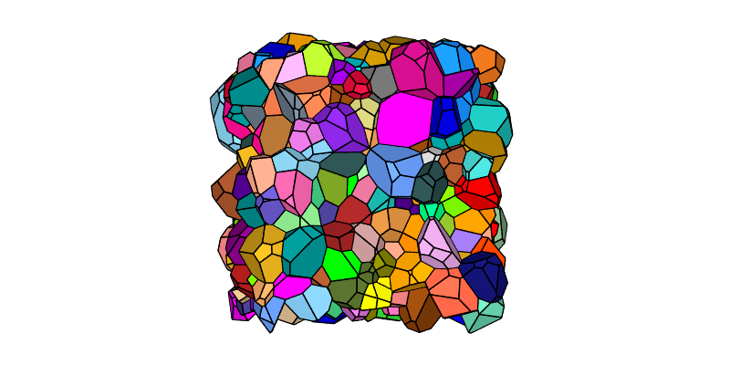
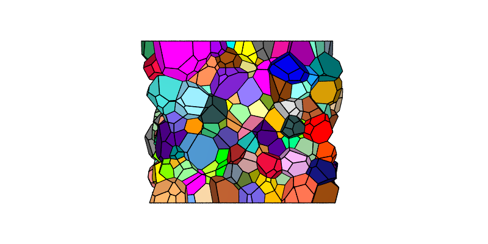
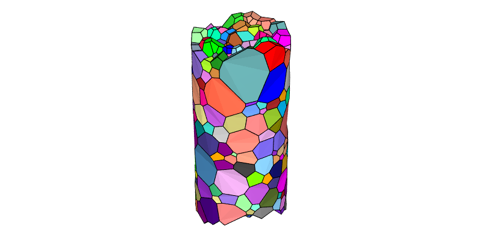

.. _periodic_tessellation:

Generating a Periodic Tessellation (-T)
=======================================

.. note::

  This tutorial presents the :option:`-periodicity` option of the :ref:`neper_t`.  Read first: :ref:`morpho_statistics`.  For details on the use of the :ref:`neper_v` in this tutorial, see :ref:`visualize_tessellation`.

  To reproduce *exactly* the images below, add the following line to your :file:`$HOME/.neperrc` file (or to a local configuration file to be loaded with :data:`--rcfile`)::

    neper -V -imagesize 800:400

Periodicity conditions can be prescribed to the domain, and therefore to the tessellation, using :option:`-periodicity`.  Periodic tessellations are typically used, with periodic boundary conditions, to avoid boundary effects in simulations and so reduce the size of the representative volume element.

Generating a Fully-Periodic Tessellation
----------------------------------------

A fully periodic tessellation of grain-growth morphology can be generated as follows:

.. code-block:: console

  $ neper -T -n 500 -morpho gg -periodicity all -o per

This produces a :ref:`tess_file` named :file:`per.tess`.

The tessellation can be visualized using the :ref:`neper_v`, along :data:`y` (using an orthographic projection):

.. code-block:: console

  $ neper -V per.tess -cameracoo x:-6.3:z -cameraprojection orthographic -print img1

The cells at the domain boundary are not cut by the domain faces, but extend beyond them, and the parts beyond a domain face correspond to the parts of other cells located on the opposite side of the domain.  This produces the typical "raspberry" shape of periodic tessellations.  The tessellation can be repeated along all directions to fill space.

Generating a Semi-Periodic Tessellation
---------------------------------------

Periodicity can also be prescribed only along some directions.  For example, a tessellation periodic along :data:`x` and :data:`y`, as needed to model a thin film or a sheet of infinite extent, can be generated as follows:

.. code-block:: console

  $ neper -T -n 500 -morpho gg -periodicity x,y -o semiper

This produces a :ref:`tess_file` named :file:`semiper.tess`.

The tessellation can be visualized along :data:`y` (using an orthographic projection):

.. code-block:: console

  $ neper -V semiper.tess -cameracoo x:-6.3:z -cameraprojection orthographic -print img2

The tessellation is periodic along :data:`x` (left and right sides) and :data:`y` (not visible) but has flat faces at :data:`z=0` and :data:`z=1` (bottom and top sides).

Generating a Semi-Periodic Cylinder
-----------------------------------

A cylindrical domain can be made periodic along its axis, as needed to model a wire of infinite length:

.. code-block:: console

  $ neper -T -n 500 -morpho gg -domain "cylinder(2,1)" -periodicity z -o cylper

This produces a :ref:`tess_file` named :file:`cylper.tess`.

The tessellation can be visualized as before:

.. code-block:: console

  $ neper -V cylper.tess -print img3

The tessellation is periodic along :data:`z`, where the cells extend beyond the domain ends (top and bottom sides), while the curved surface of the cylinder is exact.
