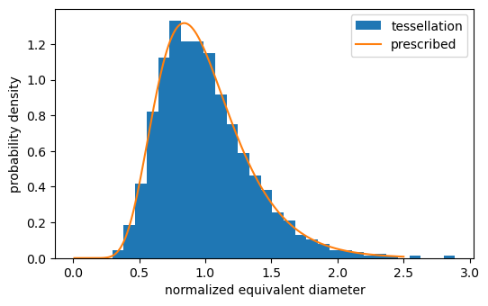
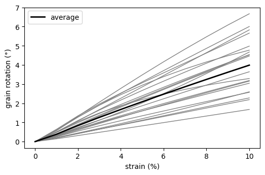
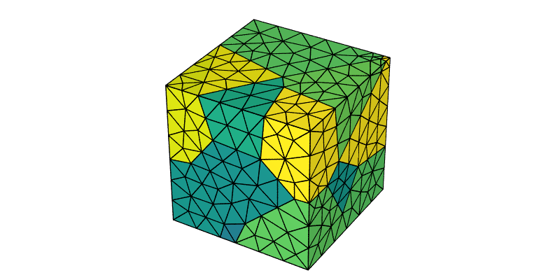

.. _python_tutorial:

Using Neper from Python
=======================

.. note::

  This tutorial presents the :ref:`python_interface`.  Read first: :ref:`morpho_statistics`, :ref:`mesh_tessellation` and :ref:`simulation_results_tutorial`.

  The plots are made with `Matplotlib <https://matplotlib.org>`_.  To reproduce *exactly* the images below, use the following settings (the Neper images are generated with :code:`imagesize="800:400"`):

  .. code-block:: python

    import numpy as np
    import matplotlib.pyplot as plt
    import neper

    neper.set_defaults(rcfile="none")
    plt.rcParams.update({"figure.figsize": (6, 3.6), "savefig.dpi": 100})

The :ref:`python_interface` runs Neper's modules from Python, reads their results into NumPy arrays, and passes NumPy arrays to Neper.  This makes it possible to combine Neper with Python's scientific libraries, e.g., to analyze tessellations, meshes and simulation results, plot them, carry out parametric studies, or visualize data computed in Python.

Analyzing the Cells of a Tessellation
-------------------------------------

A tessellation with grain-growth properties (see :ref:`morpho_statistics`) is generated with the cell equivalent diameters and sphericities as statistics:

.. code-block:: python

  res = neper.T(n=1000, morpho="diameq:lognormal(1,0.35),1-sphericity:lognormal(0.145,0.03)",
                statcell="diameq,sphericity")

The statistics are returned by :code:`res.stat("cell")`, as a dictionary indexed by the keys of :data:`statcell`.  The equivalent diameters, normalized by their average (as in :option:`-morpho`), are then compared to the prescribed lognormal distribution:

.. code-block:: python

  stat = res.stat("cell")
  diameq = stat["diameq"] / stat["diameq"].mean()

  d = np.linspace(0.01, 2.5, 200)
  s2 = np.log(1 + 0.35**2)    # lognormal distribution of mean 1 and standard deviation 0.35
  pdf = np.exp(-(np.log(d) + s2 / 2)**2 / (2 * s2)) / (d * np.sqrt(2 * np.pi * s2))

  plt.hist(diameq, bins=30, density=True, label="tessellation")
  plt.plot(d, pdf, label="prescribed")
  plt.xlabel("normalized equivalent diameter")
  plt.ylabel("probability density")
  plt.legend()
  plt.savefig("img1.png", bbox_inches="tight")

The standard deviation of :code:`diameq` is :data:`0.350`, as prescribed.

Running a Parametric Study
--------------------------

A Python loop runs Neper for different parameter values.  For example, to generate tessellations of different cell size distributions and compute the actual standard deviations:

.. code-block:: python

  for sd in [0.1, 0.2, 0.35, 0.5]:
      res = neper.T(n=200, morpho=f"diameq:lognormal(1,{sd}),1-sphericity:lognormal(0.145,0.03)",
                    statcell="diameq", o=f"sd{sd}")
      diameq = res.stat("cell")["diameq"]
      print(f"{sd:.2f} {diameq.std() / diameq.mean():.3f}")

This prints:

.. code-block:: text

  0.10 0.101
  0.20 0.200
  0.35 0.348
  0.50 0.478

.. note:: Since each run is a separate process, the runs can also be carried out in parallel, e.g. using :code:`concurrent.futures.ThreadPoolExecutor`, with a reduced number of threads each (:code:`threads=...`).

Processing Simulation Results
-----------------------------

The results of a small FEPX simulation are used (:download:`n20.sim.tgz <orientation_trajectories/n20.sim.tgz>`, see :ref:`orientation_trajectories`), which corresponds to the deformation to 10% tensile strain along :data:`z` of a 20-grain polycrystal.  The node displacements are computed by the :ref:`neper_s` (which writes them in the simulation directory; you may want to work on a copy of it), and the simulation directory is read:

.. code-block:: python

  neper.S("n20.sim", resnode="disp")
  sim = neper.read("n20.sim")

The strain is computed from the displacements of the nodes of the top domain face (whose initial height is 1):

.. code-block:: python

  disp = sim.read("nodes", "disp")                 # (steps, nodes, 3)
  top = sim.mesh().nsets["z1"] - 1
  strain = disp[:, top, 2].mean(axis=1)

The grain rotations are computed from the grain orientations, using :code:`neper.ori_angle` and the orientation descriptor of the simulation, :code:`sim.orides` (Rodrigues vectors):

.. code-block:: python

  ori = sim.read("elsets", "ori")                  # (steps, elsets, 3)
  rotation = neper.ori_angle(ori, ori[0], sim.orides)

  plt.plot(100 * strain, rotation, color="gray", lw=1)
  plt.plot(100 * strain, rotation.mean(axis=1), color="black", lw=2, label="average")
  plt.xlabel("strain (%)")
  plt.ylabel("grain rotation (°)")
  plt.legend()
  plt.savefig("img2.png", bbox_inches="tight")

Finally, the grain rotations are written to the simulation directory, as a new result, which can then be used as any other result by the :ref:`neper_s` and the :ref:`neper_v`:

.. code-block:: python

  sim.write("elsets", "rotation", rotation)
  neper.V("n20.sim", step=10, imagesize="800:400", dataelsetcol="real:rotation",
          dataelsetscale="0:6", print="img3")

