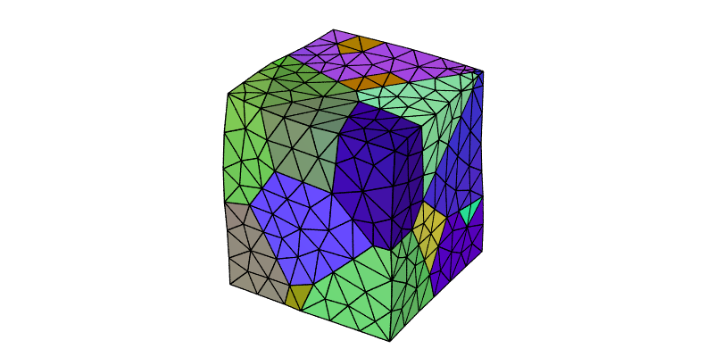
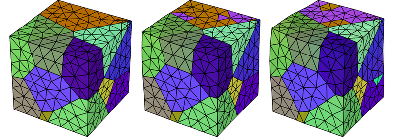
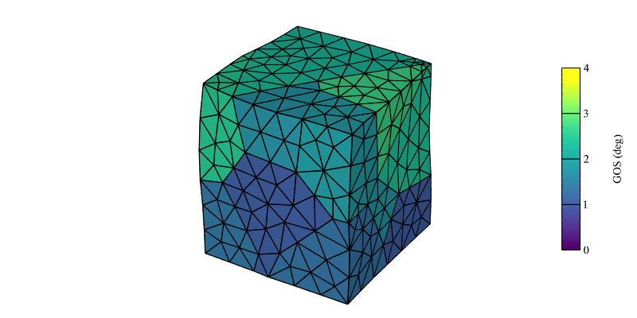

.. _simulation_results_tutorial:

Post-Processing and Visualizing Simulation Results (-S, -V)
===========================================================

.. note::

  This tutorial presents the :ref:`neper_s` and the simulation-related options of the :ref:`neper_v`.  Read first: :ref:`mesh_tessellation` and :ref:`visualize_mesh`.

  To reproduce *exactly* the images below, add the following line to your :file:`$HOME/.neperrc` file (or to a local configuration file to be loaded with :data:`--rcfile`)::

    neper -V -imagesize 800:400

In the following, the results of a small FEPX simulation are used (the :ref:`simulation_directory` :file:`n20.sim` of :ref:`orientation_trajectories`), which corresponds to the deformation to 10% (engineering) tensile strain along :data:`z` of a 20-grain polycrystal.  The simulation directory includes the node positions (:data:`coo`) and the element orientations (:data:`ori`) at steps 0 to 10.

.. note:: The :ref:`neper_s` writes the new results in the simulation directory; you may want to work on a copy of it.

Computing Results
-----------------

New results can be computed for the nodes, elements, element sets (cells) and the whole mesh, using options :data:`-resnode`, :data:`-reselt`, :data:`-reselset` and :data:`-resmesh`, respectively, and the keys described in :ref:`simulation_results`.  For example, to compute the nodal displacements and the element volumes:

.. code-block:: console

  $ neper -S n20.sim -resnode disp -reselt vol

This writes the results in :file:`n20.sim/results/nodes/disp` and :file:`n20.sim/results/elts/vol`, as one file per step (:file:`disp.step0`, etc.).

The results of element sets and of the mesh are computed from the element results, by averaging or other statistical treatments.  For example, to compute the volumes and grain orientation spreads of the element sets, and the volume of the mesh:

.. code-block:: console

  $ neper -S n20.sim -reselset vol,gos -resmesh vol

The volume of the mesh is :data:`1` at step 0 and :data:`1.000849678065` at step 10.

Defining Results from Expressions
---------------------------------

A result can be defined from an expression based on other results, using the syntax :data:`\<name\>:\<expression\>`.  A component of a vector or tensor result is obtained by appending the component to its name, as in :data:`disp3`.  For example, to compute the norm of the displacement:

.. code-block:: console

  $ neper -S n20.sim -resnode "dispnorm:sqrt(disp1^2+disp2^2+disp3^2)"

This writes the results in :file:`n20.sim/results/nodes/dispnorm`.

.. note:: Defining a name is mandatory for expressions containing divisions, as the :data:`/` character cannot be used in file names.

An existing result can be removed by prefixing its name with :data:`!`, and so a result can be overridden.  For example, to redefine :data:`dispnorm` as the norm of the displacement in the :data:`(x,y)` plane:

.. code-block:: console

  $ neper -S n20.sim -resnode '!dispnorm,dispnorm:sqrt(disp1^2+disp2^2)'

.. note:: Single quotes are used so that :data:`!` is not interpreted by the shell.

Defining New Entities
---------------------

New entities, made of element sets, can be defined using option :option:`-entity`, from an expression based on the element set variables, and results can be computed for them using :data:`-res\<entity\>`.  For example, to define the top half of the sample, :data:`tophalf`, and compute the :data:`z` coordinate of its centroid:

.. code-block:: console

  $ neper -S n20.sim -entity "tophalf:z>0.5" -restophalf z

This writes the results in :file:`n20.sim/results/tophalf/z`.  The :data:`z` coordinate is :data:`0.747181733339` at step 0 and :data:`0.811590106749` at step 10.

An entity can also comprise several members, each defined by an expression, which can be loaded from a file.  For example, to define the bottom and top halves of the sample, consider a file, :file:`foo`, containing::

  z<=0.5
  z>0.5

The entity, :data:`halves`, can be defined and the :data:`z` coordinates of the centroids of its members computed as follows:

.. code-block:: console

  $ neper -S n20.sim -entity "halves:file(foo)" -reshalves z

The values at step 10 are :data:`0.268767546062` and :data:`0.811590106749`.

.. note:: Simulation directories can also be merged, as in :data:`neper -S cycle1.sim,cycle2.sim -o cycle1-2`.

Visualizing Results
-------------------

A simulation directory can be passed to the :ref:`neper_v`, and the step to visualize can be specified using :data:`-step`.  For example, to visualize the deformed mesh, by setting the node positions from the :data:`coo` result, with the elements colored by their orientations, at step 10:

.. code-block:: console

  $ neper -V n20.sim -step 10 -datanodecoo coo -dataeltcol ori -print img1

To generate an image at several steps, a loop can be used (see :option:`-loop`).  For example, for steps 0, 5 and 10:

.. code-block:: console

  $ neper -V n20.sim -loop STEP 0 5 10 -step STEP -datanodecoo coo -dataeltcol ori -print imgSTEP -endloop

This produces PNG files named :file:`img0.png`, :file:`img5.png` and :file:`img10.png`, which can be assembled using ImageMagick's :command:`convert`:

.. code-block:: console

  $ convert img0.png img5.png img10.png -trim +repage -resize x300 -extent x300 -bordercolor white -border 10x0 +append -resize 780x -background white -gravity center -extent 800x img2.png

The results computed above can also be used.  For example, to color the element sets by their grain orientation spreads at step 10:

.. code-block:: console

  $ neper -V n20.sim -step 10 -datanodecoo coo -dataelsetcol "real:gos" -dataelsetscale 0:1:2:3:4 -dataelsetscaletitle "GOS (deg)" -print img3
  $ convert img3.png img3-scale3d.png -gravity East -composite img3.png

