.. _visualize_mesh:

Visualizing a Mesh (-V)
=======================

.. note::

  This tutorial presents the mesh-related options of the :ref:`neper_v`.  Read first: :ref:`mesh_tessellation` and :ref:`visualize_tessellation`.

  To reproduce *exactly* the images below, add the following line to your :file:`$HOME/.neperrc` file (or to a local configuration file to be loaded with :data:`--rcfile`)::

    neper -V -imagesize 800:400

A mesh can be visualized using the :ref:`neper_v`.  The entities to show can be specified (elements of the different dimensions, element sets and nodes), as well as their color, size and other properties.

In the following, the mesh of the regularized tessellation of :ref:`mesh_tessellation` is used, with cell orientations.  It is generated as follows:

.. code-block:: console

  $ neper -T -n 100 -reg 1 -crysym cubic
  $ neper -M n100-id1.tess

This produces a :ref:`tess_file` named :file:`n100-id1.tess` and a :ref:`mesh_file` named :file:`n100-id1.msh`.

Generating a Mesh Image
-----------------------

The mesh can be visualized as follows:

.. code-block:: console

  $ neper -V n100-id1.tess,n100-id1.msh -print img1

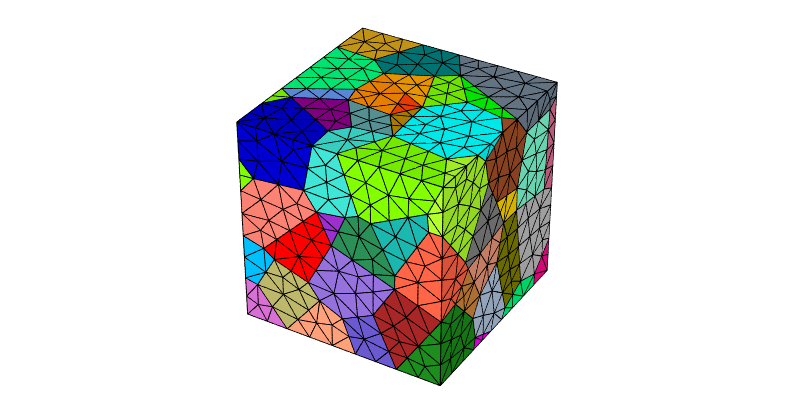

This generates a PNG image named :file:`img1.png`.  By default, the 3D elements are shown, they are colored from the ids of their element sets, and their edges appear in black.

The cell boundaries can be highlighted by superimposing the 1D elements, using :data:`-showelt1d`:

.. code-block:: console

  $ neper -V n100-id1.tess,n100-id1.msh -showelt1d all -print img2

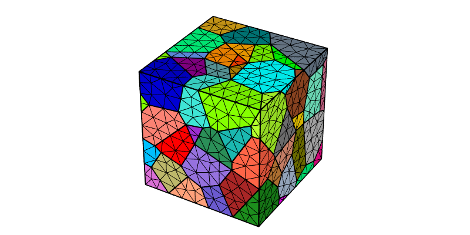

Showing Specific Entities
-------------------------

As for a tessellation, the mesh entities to show can be specified using options :data:`-show*` and expressions based on the :ref:`mesh_keys`.  For example, only some of the 3D elements can be shown, together with the 1D elements (i.e. the cell edges) of the shown elements, and the domain (option :option:`-showdomain`):

.. code-block:: console

  $ neper -V n100-id1.tess,n100-id1.msh -showelt "z<0.5" -showelt1d elt3d_shown -showdomain 1 -print img3

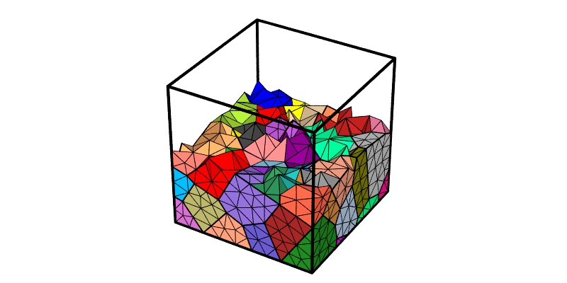

Whole element sets can also be selected, for example the interior ones (:data:`body>0`):

.. code-block:: console

  $ neper -V n100-id1.tess,n100-id1.msh -showelset "body>0" -showelt1d elt3d_shown -showdomain 1 -print img4

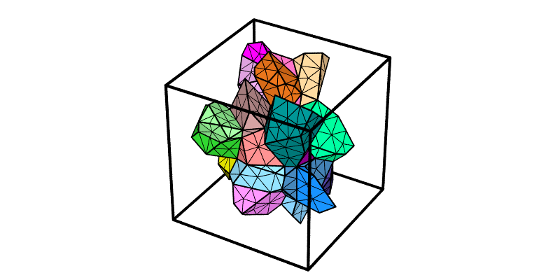

A logical expression can be arbitrarily complex.  For example, the following command only shows the interior element sets that have a volume larger than 0.012 (for an average of 0.01):

.. code-block:: console

  $ neper -V n100-id1.tess,n100-id1.msh -showelset "(vol>0.012)&&(body>0)" -showelt1d elt3d_shown -showdomain 1 -print img5

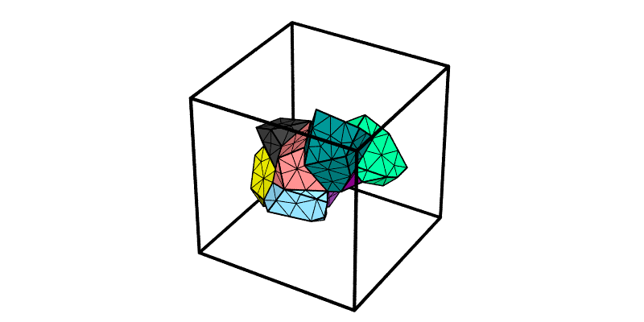

The 3D elements can be hidden, to show elements of lower dimensions.  For example, the 1D elements alone provide the skeleton of the mesh:

.. code-block:: console

  $ neper -V n100-id1.tess,n100-id1.msh -showelt3d none -showelt1d all -dataelset1dcol id -dataelt1drad "default*0.75" -print img6

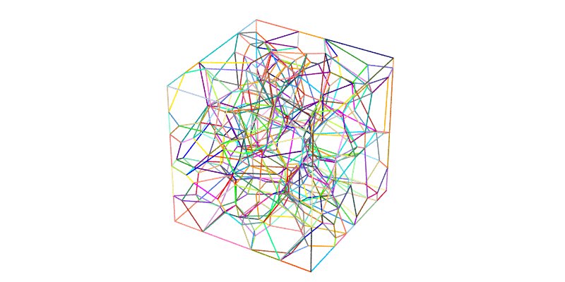

The 2D elements can be used to show the interior cell boundaries, i.e. those that are not on a domain face (:data:`domtype!=2`):

.. code-block:: console

  $ neper -V n100-id1.tess,n100-id1.msh -showelt3d none -showelset2d "domtype!=2" -dataelset2dcol id -showelt1d elt2d_shown -print img7

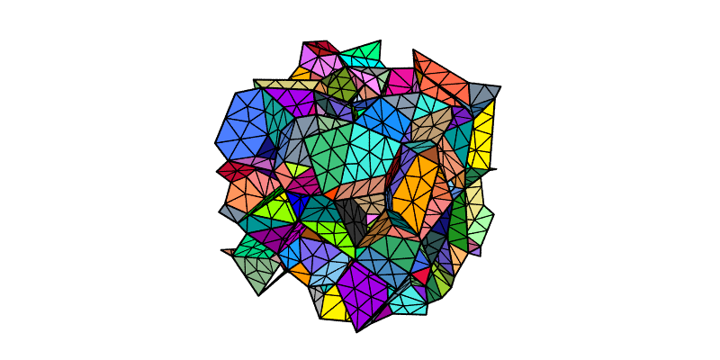

Finally, the nodes can be shown using :data:`-shownode`:

.. code-block:: console

  $ neper -V n100-id1.tess,n100-id1.msh -showelt1d all -shownode all -print img8

.. note:: In addition to an expression based on the :ref:`mesh_keys`, :data:`-shownode` can take the name of a node set of the mesh, as in :data:`-shownode nset==z1` (see :ref:`mesh_tessellation`).

Slicing the Mesh
----------------

Slices of the mesh can be printed using :option:`-slicemesh`, which takes the equations of the slicing planes, combined with :data:`,`.  For example, to get slices at :data:`x=0.5`, :data:`y=0.5` and :data:`z=0.5`:

.. code-block:: console

  $ neper -V n100-id1.tess,n100-id1.msh -slicemesh "x=0.5,y=0.5,z=0.5" -print img9

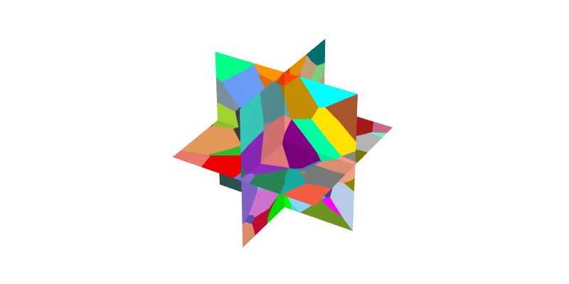

To print a series of slices, each in a separate image, a loop can be used (see :option:`-loop`).  For example, to print slices at :data:`z` coordinates ranging from 0.1 to 0.9 in steps of 0.1:

.. code-block:: console

  $ neper -V n100-id1.tess,n100-id1.msh -loop Z 0.1 0.1 0.9 -slicemesh "z=Z" -print imgZ -endloop

This produces PNG files named :file:`img0.1.png`, :file:`img0.2.png`, ..., :file:`img0.9.png`.  The first, fifth and last ones can be assembled using ImageMagick's :command:`convert`:

.. code-block:: console

  $ convert img0.1.png img0.5.png img0.9.png -trim +repage -resize x300 -extent x300 -bordercolor white -border 10x0 +append -resize 780x -background white -gravity center -extent 800x img10.png

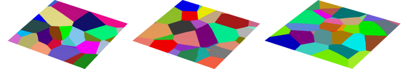

Setting Color, Transparency, Size, etc.
---------------------------------------

The way entities are represented can be specified using options :data:`-data*`.  The entities of a mesh are the elements of the different dimensions (:data:`elt` for the highest dimension, or :data:`elt0d` to :data:`elt3d`), the element sets (:data:`elset`, or :data:`elset0d` to :data:`elset3d`) and the nodes (:data:`node`).

Coloring Element Sets by Orientations
~~~~~~~~~~~~~~~~~~~~~~~~~~~~~~~~~~~~~

The following command colors the element sets by orientation:

.. code-block:: console

  $ neper -V n100-id1.tess,n100-id1.msh -dataelsetcol ori -showelt1d all -print img11

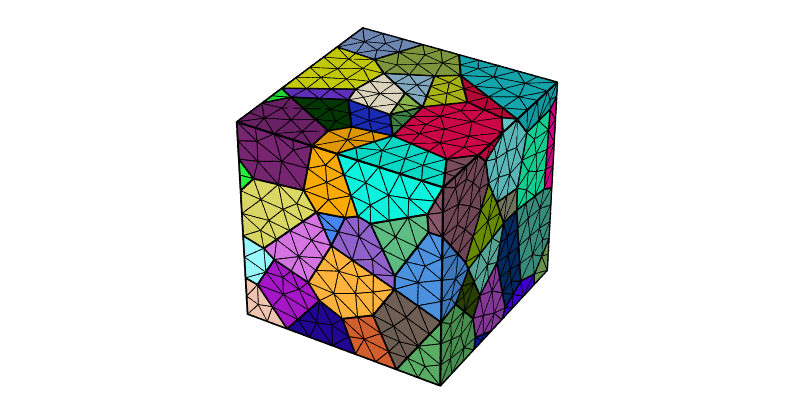

The color scheme can be changed to IPF as follows:

.. code-block:: console

  $ neper -V n100-id1.tess,n100-id1.msh -dataelsetcol ori -dataelsetcolscheme ipf -showelt1d all -print img12

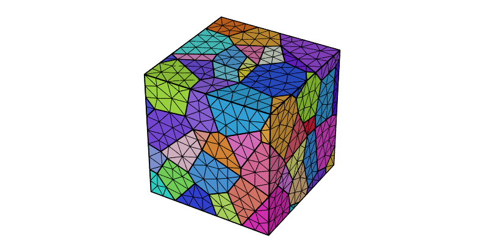

.. note:: The orientation color keys can be obtained as detailed in :ref:`orientation_color_key`.

Coloring Entities from Integer Values
~~~~~~~~~~~~~~~~~~~~~~~~~~~~~~~~~~~~~

The entities can be colored from integer values.  For example, the element sets can be colored from their body levels, here for the half :data:`y>0.5` of the domain to reveal the interior:

.. code-block:: console

  $ neper -V n100-id1.tess,n100-id1.msh -dataelsetcol int:body -showelset "y>0.5" -showelt1d elt3d_shown -showdomain 1 -print img13

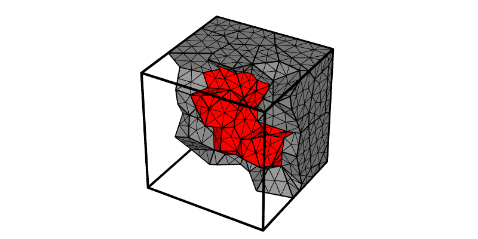

The element sets at the domain boundary (body level 0) appear in gray and the others (body level 1) in red, according to the color palette (see :ref:`color_map_for_integer_values`).

Coloring Entities from Real Values
~~~~~~~~~~~~~~~~~~~~~~~~~~~~~~~~~~

The elements can be colored from real values, for example from their radius ratios (a measure of their quality):

.. code-block:: console

  $ neper -V n100-id1.tess,n100-id1.msh -dataeltcol real:rr -dataeltscale 0.00:0.25:0.50:0.75:1.00 -dataeltscaletitle "Radius ratio" -showelt1d all -print img14
  $ convert img14.png img14-scale3d.png -gravity East -composite img14.png

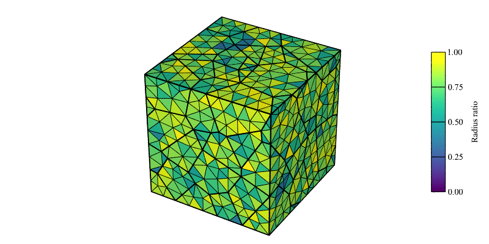

This originally produces a PNG file named :file:`img14.png` for the mesh and a PNG file named :file:`img14-scale3d.png` for the scale bar, which is included in :file:`img14.png` thanks to :program:`convert`.

.. note:: Values can also be loaded from a :ref:`data_file`, using :data:`real:file(<file_name>)`.

Mathematical expressions can be used and the color key (see :ref:`color_map_for_real_values`) can be changed, using option :data:`-dataeltcolscheme`:

.. code-block:: console

  $ neper -V n100-id1.tess,n100-id1.msh -dataeltcol "real:x*sqrt(y)*sqrt(z)" -dataeltscale 0.00:1.00 -dataeltscaletitle "x*sqrt(y)*sqrt(z)" -dataeltcolscheme heat -showelt1d all -print img15
  $ convert img15.png img15-scale3d.png -gravity East -composite img15.png

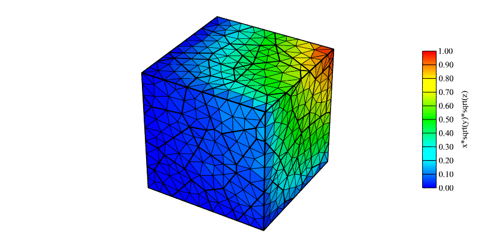

The elements can also be colored from nodal values, which are then interpolated over the elements (:data:`from_nodes`):

.. code-block:: console

  $ neper -V n100-id1.tess,n100-id1.msh -datanodecol real:z -dataeltcol from_nodes -datanodescale 0.00:0.25:0.50:0.75:1.00 -datanodescaletitle "z" -showelt1d all -print img16
  $ convert img16.png img16-scalen.png -gravity East -composite img16.png

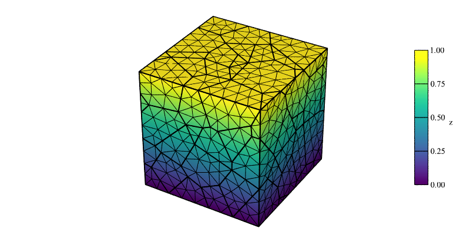

In this case, the scale bar is written in :file:`img16-scalen.png`.

Other entities can be colored in the same way.  For example, to color the element sets from their volumes:

.. code-block:: console

  $ neper -V n100-id1.tess,n100-id1.msh -dataelsetcol real:vol -dataelsetscale 0.005:0.010:0.015 -dataelsetscaletitle "Volume" -showelt1d all -print img17
  $ convert img17.png img17-scale3d.png -gravity East -composite img17.png

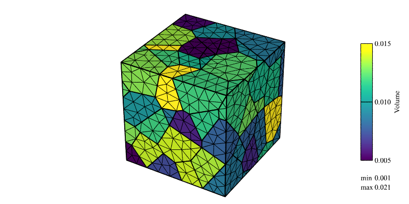

To color the 1D elements from their lengths:

.. code-block:: console

  $ neper -V n100-id1.tess,n100-id1.msh -showelt3d none -showelt1d all -dataelt1dcol real:length -dataelt1dscale 0.06:0.08:0.10:0.12:0.14 -dataelt1dscaletitle "Length" -print img18
  $ convert img18.png img18-scale1d.png -gravity East -composite img18.png

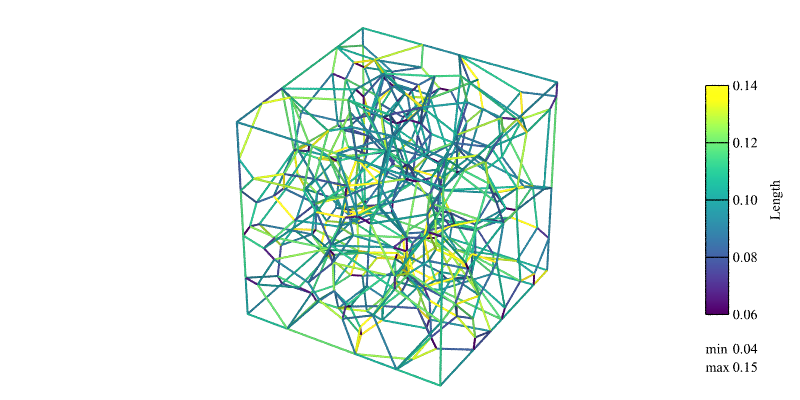

To color the nodes from their :data:`z` coordinates:

.. code-block:: console

  $ neper -V n100-id1.tess,n100-id1.msh -dataeltcol lightgray -shownode all -datanodecol real:z -datanoderad "default*1.5" -datanodescale 0.00:0.25:0.50:0.75:1.00 -datanodescaletitle "z" -showelt1d all -print img19
  $ convert img19.png img19-scalen.png -gravity East -composite img19.png

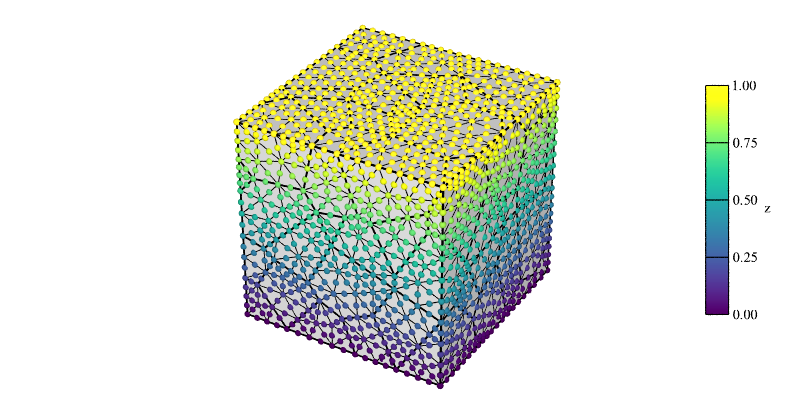

Making Elements Transparent
~~~~~~~~~~~~~~~~~~~~~~~~~~~

The transparency level of the 2D elements and element sets can be specified using options :data:`-dataelt2dtrs` and :data:`-dataelset2dtrs`.  The transparency ranges from :data:`0` (fully opaque) to :data:`1` (fully transparent).  The example below shows all 2D elements, colored from their :data:`z` coordinates:

.. code-block:: console

  $ neper -V n100-id1.tess,n100-id1.msh -showelt3d none -showelt2d all -dataelt2dcol real:z -dataelt2dtrs 0.7 -showelt1d all -print img20

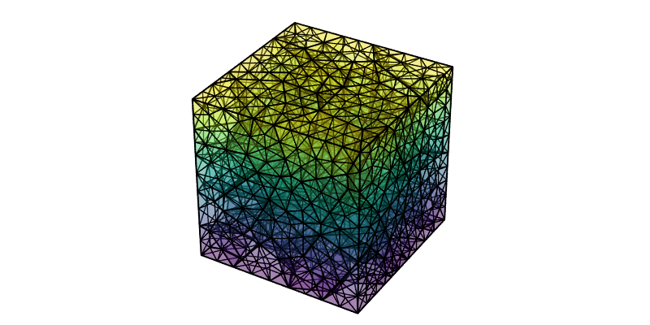

Changing the Entity Radius and Color
~~~~~~~~~~~~~~~~~~~~~~~~~~~~~~~~~~~~

The radius of the entities can be modified using options such as :data:`-dataelt1drad`, :data:`-datanoderad` and, for the edges of the 2D and 3D elements, :data:`-dataelt2dedgerad` and :data:`-dataelt3dedgerad`.  For example, to plot thin element edges and thick 1D elements, which highlights the cell boundaries:

.. code-block:: console

  $ neper -V n100-id1.tess,n100-id1.msh -dataelt3dedgerad "default*1.5" -showelt1d all -dataelt1drad "default*2" -print img21

The color of the edges of the 2D and 3D elements can be set using options :data:`-dataelt2dedgecol` and :data:`-dataelt3dedgecol`.  For example, to plot dark gray element edges, which further distinguishes them from the 1D elements:

.. code-block:: console

  $ neper -V n100-id1.tess,n100-id1.msh -dataelt3dedgerad "default*1.5" -dataelt3dedgecol darkgray -showelt1d all -dataelt1drad "default*2" -print img22

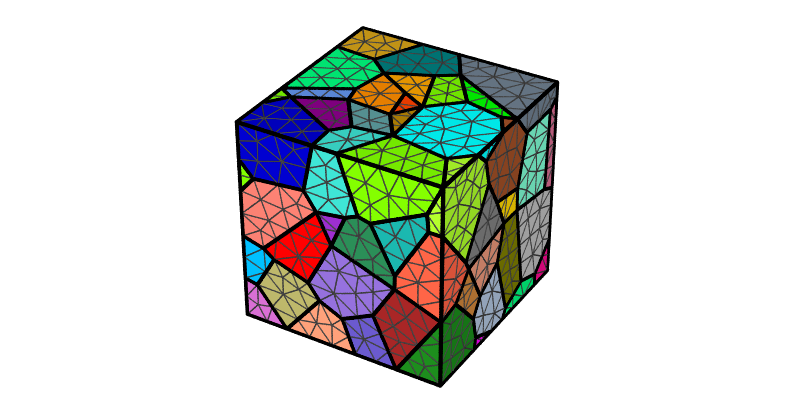

Visualizing a 2D Mesh
---------------------

A 2D mesh is visualized in the same way.  Its highest-dimension elements are the 2D elements, whose edges can be set using :data:`-dataelt2dedgerad`:

.. code-block:: console

  $ neper -T -n 100 -dim 2 -reg 1 -o n2d
  $ neper -M n2d.tess
  $ neper -V n2d.tess,n2d.msh -dataelt2dedgerad "default*0.25" -showelt1d all -print img23

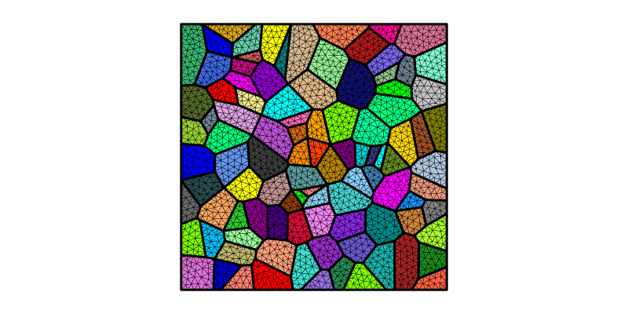

Changing the General Settings
-----------------------------

The general settings, which include the camera, the projection type, the light effects, the background color and the image size, are the same as for a tessellation (see :ref:`visualize_tessellation`).
