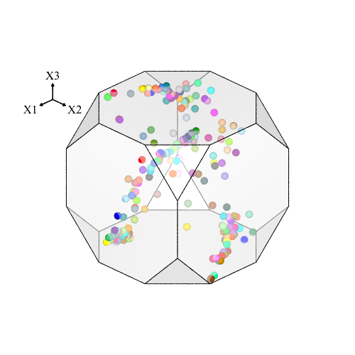
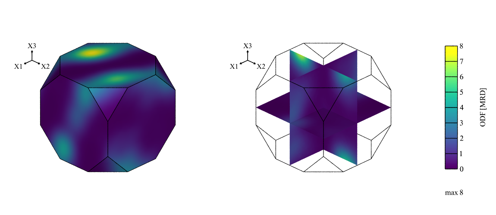
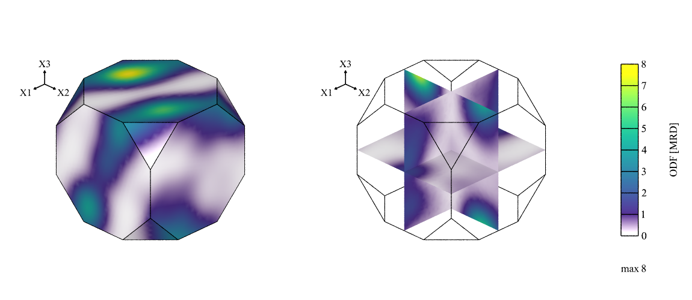
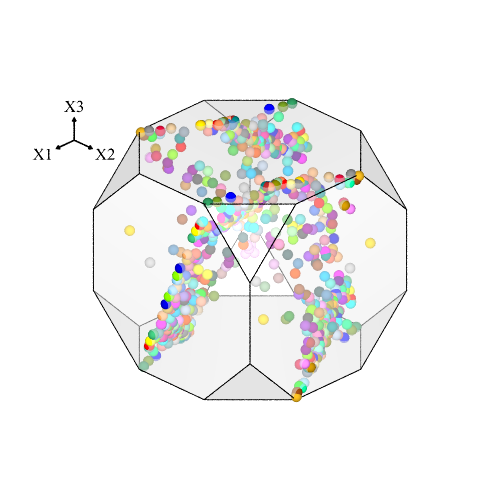
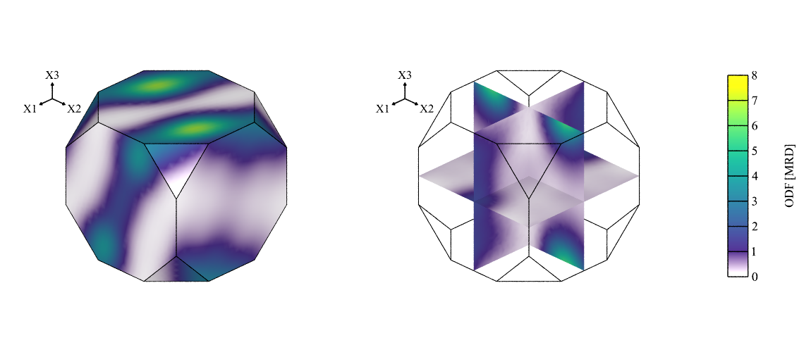

.. _visualize_ori:

Visualizing in Orientation Space (-V)
=====================================

.. note::

  This tutorial presents the :data:`ori` value of option :option:`-space` and options :option:`-orimode` and :option:`-orisym` of the :ref:`neper_v`.  Read first: :ref:`visualize_tessellation` and :ref:`pole_figure`.

  To reproduce *exactly* the images below, add the following line to your :file:`$HOME/.neperrc` file (or to a local configuration file to be loaded with :data:`--rcfile`)::

    neper -V -imagesize 500:500

Orientations can be visualized directly in orientation space using the :ref:`neper_v`, by switching to orientation space, using :option:`-space` :data:`ori`.  The orientations are represented in the fundamental region of Rodrigues space, for the crystal symmetry of the input.  As for pole figures, orientation-space visualization works in the same way as visualization in standard, real space, and a cell orientation is denoted :data:`cell`, so that options such as :data:`-showcell` and :data:`-datacellcol` can be used.

A tessellation with typical rolling orientations is used in the following: :download:`n200-psc.tess <pole_figure/n200-psc.tess>`.

Generating a Symbol Plot
------------------------

The orientations can be visualized as follows:

.. code-block:: console

  $ neper -V n200-psc.tess -space ori -print img1

This generates a PNG image named :file:`img1.png`.  By default, each orientation is represented using a symbol, which is colored from the cell id.

Generating a Density Plot
-------------------------

The distribution of the orientations can be represented as a density field using :option:`-orimode` :data:`density`.  The scale can be specified using :data:`-datacellscale`:

.. code-block:: console

  $ neper -V n200-psc.tess -space ori -orimode density -datacellscale 0:1:2:3:4:5:6:7:8 -print img2

The density is expressed in multiples of a random distribution (MRD).  By default, it is shown on the surface of the fundamental region (left) and on orthogonal slices (right), and the scale bar is included in the image.  The layout can be changed using :option:`-orilayout`, which can be set to :data:`surface` or :data:`slices`.

To focus on the regions of high density, the start of the color map can be faded to white using the :data:`fade` modifier of :data:`-datacellcolscheme` (see :ref:`color_map_for_real_values`).  The fading threshold is relative to the color scale, so that, for a scale ranging from 0 to 8, everything below 1 is faded using a threshold of :math:`1/8=0.125`:

.. code-block:: console

  $ neper -V n200-psc.tess -space ori -orimode density -datacellscale 0:1:2:3:4:5:6:7:8 -datacellcolscheme "viridis:fade(0.125)" -print img3

Enforcing Sample Symmetry
-------------------------

Orthotropic sample symmetry, as expected for rolling, can be enforced using :option:`-orisym` :data:`orthotropic`.  Each orientation is then represented together with its 3 images by the rotations of 180 degrees about the sample axes, which have the same color as the orientation:

.. code-block:: console

  $ neper -V n200-psc.tess -space ori -orisym orthotropic -print img4

The symmetry also applies to density plots:

.. code-block:: console

  $ neper -V n200-psc.tess -space ori -orimode density -datacellscale 0:1:2:3:4:5:6:7:8 -datacellcolscheme "viridis:fade(0.125)" -orisym orthotropic -print img5

.. note:: Option :option:`-orisym` is the equivalent of :data:`-pfsym` for pole figures (see :ref:`pole_figure`).
